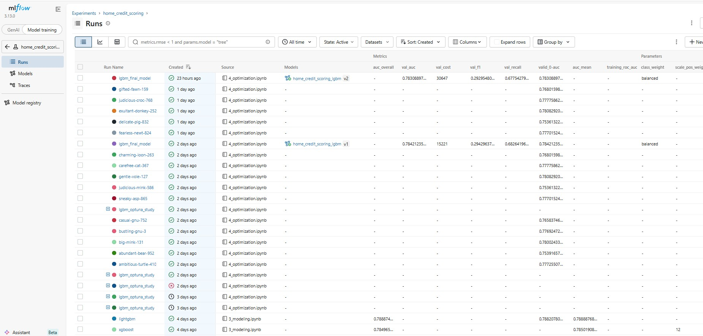

# 📊 P6 – Initiez-vous au MLOps : scoring crédit et suivi MLflow

Projet du parcours *Data Scientist Machine Learning* (OpenClassrooms).

Modèle de scoring crédit (Home Credit) entraîné et suivi de bout en bout avec MLflow : comparaison de modèles, optimisation des hyperparamètres avec Optuna, coût métier asymétrique (10 × FN + FP), optimisation du seuil de décision et enregistrement du modèle final dans le Model Registry.

**Stack :** Python · pandas · scikit-learn · LightGBM · XGBoost · Optuna · MLflow

## 📸 Suivi des expérimentations dans MLflow

Les autres captures du dossier détaillent le modèle final (métriques et hyperparamètres), l'importance des variables et la courbe coût métier / seuil.

## 📝 Évaluation

**Validé le 23 juin 2026**

### Notes de l'évaluateur

- **Identifier les hyperparamètres** : Hyperparamètres identifiés, optimisés via grid search et loggués dans MLflow.
- **Optimiser les fonctions d'activation** : Validé.
- **Gérer l'overfitting et l'underfitting avec les techniques adéquates** : Métriques et loss d'entraînement et de test, et leur évolution relative, suivies pour détecter l'overfitting.
- **Surveiller la qualité des features** : Exploration et nettoyage des données effectués, feature importance suivie.
